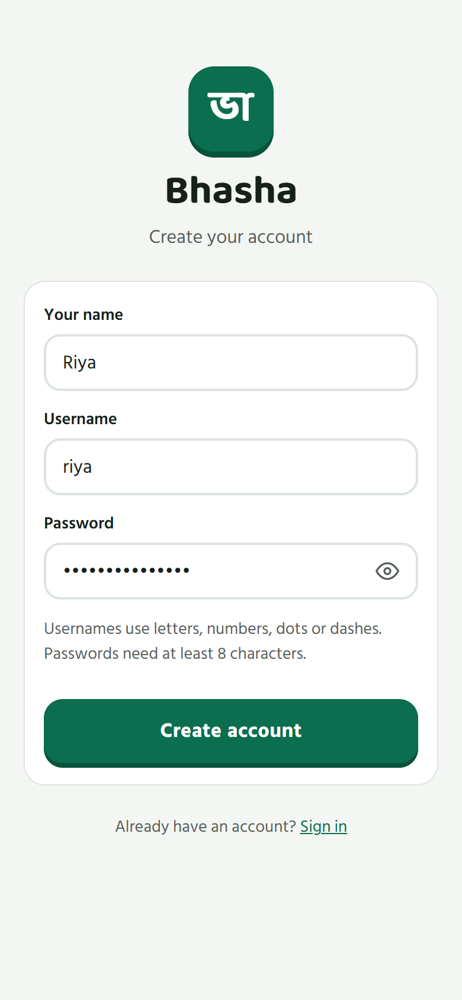
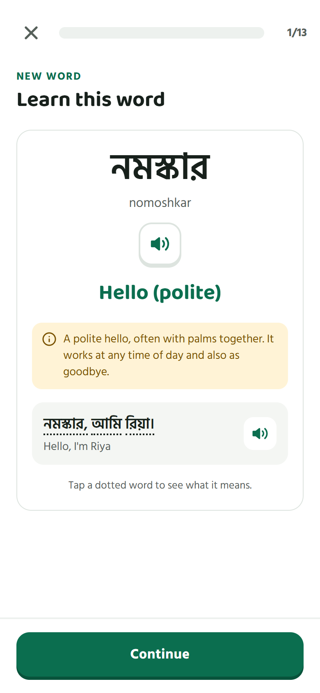
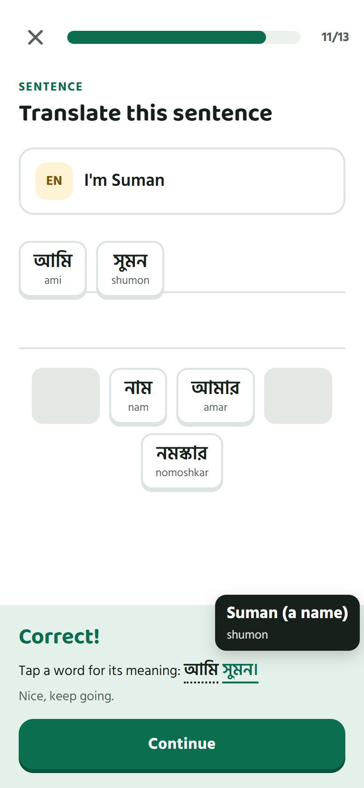
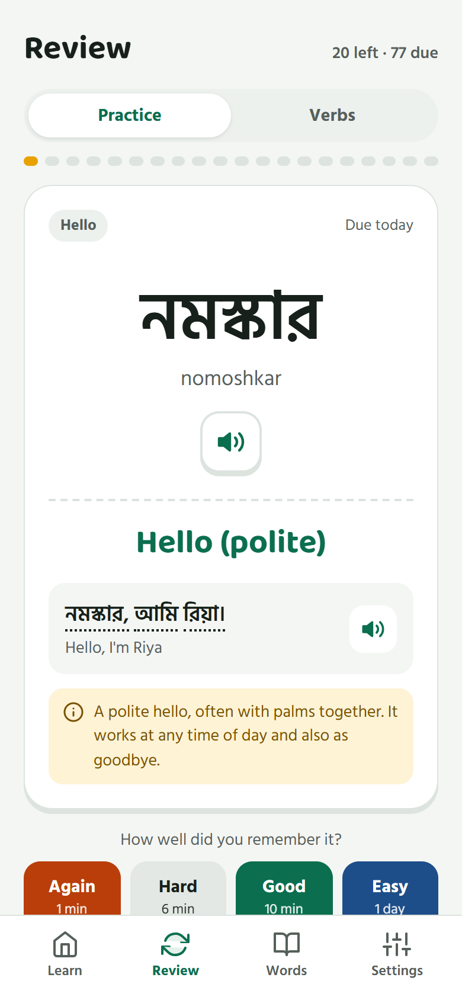
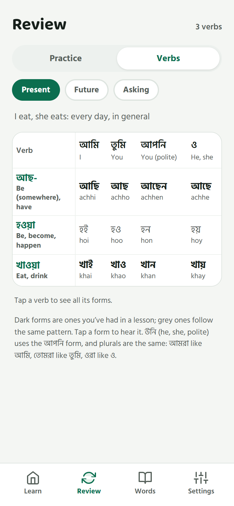

# Bhasha (ভাষা): learn Bengali, free

A free Bengali course in a small app that works in any phone browser. No ads, no subscription, no
hidden costs. The course is written with AI, played and corrected by a native speaker, and improved
from learners' feedback.

**Try it:** [bengali.paulsuvro.com](https://bengali.paulsuvro.com) · **Feedback:** [open an issue](https://github.com/suvrojotiPaul/Bangla-Bhasa/issues)

<p align="center">
  
</p>

## Why this exists

I'm a Bengali from West Bengal, living far from home in another country. I spend my days learning
other people's cultures and languages, and I want to share mine. The food and the festivals are
easy to share. The language isn't: no platform teaches it for free, with no ads and no hidden
costs. Duolingo, the most popular one, doesn't teach Bengali at all.

So when people told me "I can't learn Bengali, it isn't easily available", I knew I had to do
something.

The idea is simple:

1. **Write the course with AI.**
2. **Have it reviewed** by a native speaker, lesson by lesson.
3. **Collect feedback** from the people learning with it, and fix what they find.
4. **Keep it free and online, for everyone.**

## What's in it

The **A1 course** is complete: 28 units, 106 lessons plus a review for each unit, 401 words and 737
everyday sentences. It goes from নমস্কার (hello) to shopping at the bazaar, asking the way,
talking about your day and being polite on the phone. A2 to B2 come next.

| | |
|---|---|
| **Learn, then practise** | Each new word gets a card (sound, meaning, a note on usage, an example), then multiple choice, listening, sentence building and matching. |
| **Tap any word** | Every Bengali word in a sentence can be tapped for its meaning and romanization. |
| **Spaced repetition** | Words come back for review just before you would forget them ([FSRS](https://github.com/open-spaced-repetition/ts-fsrs)). |
| **Verb table** | Every verb you've met, by tense and person, growing as you learn. |
| **Meanings in English or French** | Romanization can be switched off once you can read the script. |
| **Reminders** | An optional nudge at 9:00, 15:00 and 21:00 if you haven't practised. Installs like an app on Android and iPhone. |
| **No hearts, no ads** | A mistake just brings the word back for review. |

<p align="center">
  
  
  
  
</p>

## Run it on your computer

You need **Node.js 22 or newer** (npm comes with it) and **git**. Check with `node -v`. Nothing else:
the database is a single SQLite file, and there is no build step.

```bash
git clone https://github.com/suvrojotiPaul/Bangla-Bhasa.git
cd Bangla-Bhasa
npm install
cp .env.example .env       # Windows Command Prompt: copy .env.example .env
```

Open `.env` and choose an admin login: set `ADMIN_USERNAME` and `ADMIN_PASSWORD` (8 characters or
more). Then:

```bash
npm start
```

Open <http://localhost:3000>. The first start builds the course into `data/bhasha.sqlite` in about a
second; nothing is downloaded. Sign in with your admin login, or create a learner account.

### Dependencies

`npm install` fetches everything the app needs: [Express 5](https://expressjs.com/) (the web
server), [better-sqlite3](https://github.com/WiseLibs/better-sqlite3) (the database) and
[ts-fsrs](https://github.com/open-spaced-repetition/ts-fsrs) (review scheduling). The frontend is
plain JavaScript with no framework, so there is nothing to build.

better-sqlite3 downloads a ready-made binary for most systems. If `npm install` fails while
building it, install the build tools and run `npm install` again:

- **Windows:** [Visual Studio Build Tools](https://visualstudio.microsoft.com/visual-cpp-build-tools/)
  with "Desktop development with C++", plus [Python 3](https://www.python.org/downloads/)
- **macOS:** `xcode-select --install`
- **Debian / Ubuntu:** `sudo apt install build-essential python3`

### Settings (`.env`)

| Variable | Default | What it does |
|---|---|---|
| `PORT` | `3000` | The port the app listens on |
| `HOST` | `127.0.0.1` | `127.0.0.1` = this computer only; `0.0.0.0` = other devices on your network too |
| `DB_PATH` | `./data/bhasha.sqlite` | The database: course, accounts and progress |
| `CURRICULUM_PATH` | `./data/course` | The course folder |
| `ADMIN_USERNAME`, `ADMIN_PASSWORD` | empty | The one admin account, set again from `.env` on every start |

Without a `.env` file the app still starts with these defaults, but with no admin account.

### Use it on your phone

Set `HOST=0.0.0.0` in `.env`, restart, and open `http://<your computer's IP>:3000` on a phone on
the same Wi-Fi. Lessons and reviews work over plain HTTP. Installing it as an app and practice
reminders need HTTPS (or `localhost`), so for those, put the app behind an HTTPS reverse proxy.

### Updating and backups

- **Update:** `git pull`, then restart. The course rebuilds itself when its files change, and
  everyone's progress is kept.
- **Back up:** everything is in `data/bhasha.sqlite`. Stop the app, then copy the
  `data/bhasha.sqlite*` files.

### Other commands

- `npm run dev`: restarts when a server file changes.
- `npm run course:dev`: runs on its own database (`data/bhasha-course.sqlite`), restarts when a
  course file changes and reloads the open page. Handy while editing units.
- `npm run check-course`: checks the course files (untaught words in sentences, words without
  enough sentences, missing fields).

### Common problems

- **`npm install` fails on better-sqlite3:** install the build tools above.
- **The server won't start:** check that `node -v` shows 22 or newer.
- **Port 3000 is already in use:** set another `PORT` in `.env`.
- **The admin can't sign in:** check `ADMIN_USERNAME` and `ADMIN_PASSWORD` in `.env` (8+
  characters) and restart. On start, the server prints any problem with `.env` (lines starting
  with `[config]` or `[admin]`).

## Feedback and contributing

- **Found a mistake?** A wrong word, an unnatural sentence, a bug:
  [open an issue](https://github.com/suvrojotiPaul/Bangla-Bhasa/issues). Say which unit or screen, and what it should be.
- Pull requests are welcome. Course changes are played by a native speaker before they go live.

---

## Reference

### Accounts

Each person who uses the app signs in and gets their own progress, review schedule, streak and
settings. Everything stays in the same SQLite file.

- Anyone can create an account from the sign-in screen ("Create an account").
- The admin is set in `.env` with `ADMIN_USERNAME` and `ADMIN_PASSWORD`. On every start the
  server creates that account if needed and sets its password from `.env`; it is the only admin.
  Change the admin password in `.env` and restart.
- The admin sees **Settings → People dashboard**: everyone's time in the app each day (last 14
  days), XP, streak, lessons and words, and can set a new password for someone or remove an
  account.
- Time counts while the app is open on screen and someone has tapped, typed or scrolled in the
  last 2 minutes. The app reports every 30 seconds; two open tabs don't count twice.
- Passwords are stored as scrypt hashes (Node's built-in `crypto`). Signing in sets an
  `HttpOnly` cookie holding a random token; the database keeps only its SHA-256. A session lasts
  30 days from when it was last used.
- Ten wrong passwords, or five new accounts, from one address within 15 minutes are refused
  for the rest of that time.
- Without an HTTPS proxy the app runs over plain HTTP, so on a home network a password could be
  read by someone watching that network. Keep `HOST=0.0.0.0` to networks you trust.

### Sound

Words and sentences are spoken by the browser's own Bengali voice, preferring an Indian Bengali
(bn-IN) one. Most Android phones and Microsoft Edge have one; Firefox on Windows has none, and
**iPhones have none in any browser**. Without a Bengali voice, words are silent and listening
exercises are skipped; Settings says so on that device.

### Practice reminders and installing the app

- On Android, Chrome offers **Install app** (menu → Install app / Add to home screen): the app opens
  full screen with its own icon (`public/manifest.webmanifest`, `public/icons/`).
- **App guide** (`public/js/components/guide.js`): the first time Home opens on a device, a short
  three-step guide shows what's new, how to install the app (a one-tap Install button when Chrome
  offers it, otherwise the ⋮ → Install app steps with a sketch of Chrome's menu) and a button to
  turn on reminders. Settings → App guide opens it again. Bump `GUIDE_VERSION` when there is
  something new to show: every device sees the guide once more.
- **Reminders** are on by default for every learner, but each device must allow notifications:
  Home shows a "Get practice reminders" card until the learner taps Turn on or Not now. Settings →
  Practice reminders switches them on or off for that device and can send a test.
- The server sends a reminder at **9:00, 15:00 and 21:00 in the device's time zone**, only if the
  learner hasn't finished a lesson or a review in the last 6 hours, at most one per slot. A slot
  is only used during its first hour, so a server that was off doesn't send late reminders.
- How: web push with VAPID (`server/services/push.js`, keys made on first start and kept in the
  database). The message ("12 words to review" or the next lesson) travels encrypted in the push
  (RFC 8291, done with `node:crypto`, so no extra package); `public/sw.js` shows it and opens Review
  or Home on tap. A device saved without its keys gets an empty push, and the service worker asks
  `/api/reminders/message` instead. Only real push services (Google, Mozilla, Apple, Microsoft) are
  accepted as endpoints. Needs HTTPS (localhost works too).
- **iPhone** (iOS 16.4 or later): reminders only work in the Home Screen app. The guide walks
  iPhone users through Safari → Share → Add to Home Screen, then turning reminders on inside the
  app (which keeps its own sign-in). Settings explains what's missing on an older iPhone or in a
  Safari tab.

### Writing course units

`data/course/` holds the A1 course. Each unit is its own file under `data/course/a1/`, listed in
order in `data/course/course.json`. A unit has its new `words` (romanization, English and French
meaning, part of speech, an optional note, and `forms`: inflected forms that give tap hints and
count as the word in sentences), `extra` (names and places its sentences use without teaching
them), `lessons` (which words each lesson teaches) and `sentences`.

The verb table comes from `data/course/verbs.json`: each verb's stem and any irregular forms; the
regular forms are made from the endings in `server/importers/verbs.js`.

Run `npm run check-course` after editing.

### Meanings and hints

- A lesson teaches each new word on a card (word, sound, meaning, an example sentence) right
  before the first question about it.
- Bengali words in example sentences, and in the right answer to a sentence exercise, have a
  dotted underline: tap one for its meaning, romanization and sound. Forms like জলের show the
  meaning of জল. After a multiple-choice question, every option shows its meaning.
- **Settings → Meanings in** picks English or Français. French comes from the `fr` fields in
  the course files (every course word, form and sentence has one). To add a language, add it to
  `server/services/languages.js` and give the course words and sentences that key.

### Notes

- Answers are compared after Unicode NFC normalization, with punctuation such as `।` ignored.
  Words grouped under `variants` in `course.json` count as the same word, and any Bengali
  sentence with the same English translation is accepted.
- Vulgar forms are listed under `rudeWords` in `data/course/course.json`. The course won't build if
  a course word or sentence uses one, so they can't slip in.
- A wrong answer in a lesson puts that word in the review queue. There are no hearts.
- A whole unit opens at once: its lessons can be taken in any order, and the next unit opens
  when they're all done. Every unit ends with a **Unit review** (a random mix of all its words
  and 4 of its sentences), which is optional for moving on. The admin sees every unit open.
- The frontend is served under `/v/<version>/`, a hash of everything in `public/`
  (`server/frontend.js`). Changed files get a new URL, so after an update browsers load the new
  code without a hard refresh, even behind a caching proxy. The page
  itself (`/`) is never cached.

## License

- **Code:** [MIT](LICENSE).
- **Course content** (`data/course/`): [CC BY-SA 4.0](data/course/LICENSE). You can reuse and
  adapt it, including commercially, with credit, as long as what you make from it stays under
  the same license.
